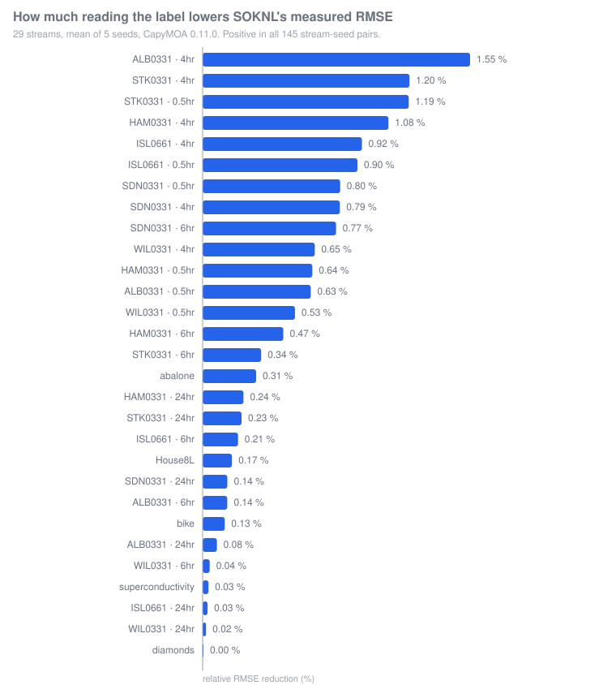
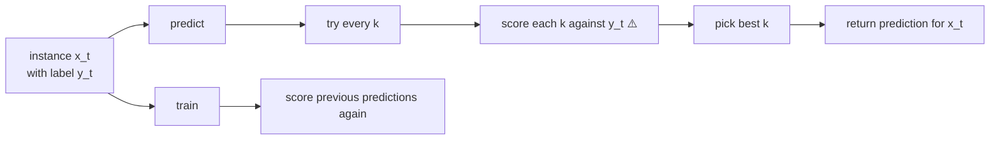

<div align="center">

# SOKNL reads the answer before it answers

**A measured label leak in the Self-Optimising K-Nearest Leaves regressor (MOA / CapyMOA)**


-orange)


</div>

---

## The finding in one paragraph

When SOKNL predicts, it scores every candidate *k* against **the true label of the very instance it is predicting**, and only then picks the best *k* and returns the prediction. In an ordinary test-then-train loop the instance handed to `predict` carries its label, so the prediction depends on the answer it is supposed to produce.

We isolated the effect with a control that changes nothing else, measured it on 29 streams, and found it is **systematic but small**. It does not overturn the conclusions we were able to check.

> [!IMPORTANT]
> This is a bug report with evidence, not a claim that published SOKNL results are wrong. Where SOKNL wins clearly, it still wins with the label hidden.

## Key findings

| # | Finding | Evidence |
|---|---|---|
| 1 | SOKNL's predictions change when the label is hidden from `predict` | 29 of 29 streams, 5 of 5 seeds each |
| 2 | The control method does not change at all | ARF-Reg is **bit-identical** on all 29 streams |
| 3 | Seeing the label always helps | RMSE is lower in **145 of 145** stream–seed pairs |
| 4 | The help is small | 0.00 %–0.31 % on five tabular streams; 0.02 %–1.55 % on 24 electricity-price files |
| 5 | Close races flip, clear wins do not | SOKNL beats ARF-Reg on 21/29 streams as usual, 16/29 with the label hidden; all 5 flips are near-ties (< 2 % apart) |
| 6 | Pre-registered verdict | **"does not depend"**: no data source flips |

<div align="center">

</div>

| Source | RMSE reduction from reading the label | SOKNL advantage over ARF-Reg: usual → label hidden |
|---|---|---|
| abalone | 0.31 % | +4.6 % → +4.3 % |
| bike | 0.13 % | −2.3 % → −2.4 % |
| diamonds | 0.00 % | +23.1 % → +23.1 % |
| House8L | 0.17 % | +0.8 % → +0.6 % |
| superconductivity | 0.03 % | +0.6 % → +0.5 % |
| NZEP (24 files) | 0.02 %–1.55 %, median ≈ 0.5 % | 5 of 24 flip |

Full per-stream table: [`results/per_stream.csv`](results/per_stream.csv).

## Where it happens

`moa.classifiers.meta.SelfOptimisingKNearestLeaves`, still present on MOA `master` when checked on 2026-11-21:

```java
// getVotesForInstance(Instance instance)  — i.e. at PREDICTION time
InstanceExample example = new InstanceExample(instance);          // carries the true label
for (int i = 0; i < n; i++) {
    double[] temporaryPrediction = {getKNLPrediction(instance, i + 1, candidates, distances)};
    this.selfOptimisingEvaluators[i].addResult(example, temporaryPrediction);   // scored with the label
    performances[i] = this.selfOptimisingEvaluators[i].getSquareError();
    this.previousPrediction[i] = temporaryPrediction[0];
}
int k = indexOfSmallestValue(performances);                        // k chosen after seeing it
return new double[]{this.previousPrediction[k]};
```



`trainOnInstanceImpl` already scores the stored per-k predictions when the label legitimately arrives, so each instance is counted twice: once too early, once on time.

## How the effect was isolated

The difficulty is hiding the label without disturbing anything else. Replacing it with a placeholder does not work: SOKNL then scores its candidates against a false value (we made that mistake in an earlier study and it exaggerated the effect almost five-fold).

The control used here:

- `BasicRegressionPerformanceEvaluator.addResult` ignores instances whose **weight is 0**.
- So the instance given to `predict` gets weight 0; attributes and label value stay identical.
- Training always uses the normal weight-1 instance.
- A method that does not read the label at predict time must be unaffected. ARF-Reg is, bit for bit.

## Reproduce it in two minutes

No dataset required:

```bash
pip install capymoa==0.11.0        # needs a Java runtime
python reproduce/minimal_repro.py
```

```text
SOKNL              identical predictions: False | RMSE usual 0.94207 | RMSE label hidden 0.94387
ARF-Reg (control)  identical predictions: True  | RMSE usual 0.90273 | RMSE label hidden 0.90273
```

The full 29-stream study is in [`study/`](study/); see [`study/README.md`](study/README.md).

## Suggested fix

Remove the evaluator update from `getVotesForInstance` and rely on the one already in `trainOnInstanceImpl`, choosing *k* from errors accumulated up to the previous instance. A draft of the maintainer report is in [`ISSUE_DRAFT.md`](ISSUE_DRAFT.md).

## Method

| Step | What was done |
|---|---|
| Protocol | Written and committed before any code ([`study/PROTOCOL_PSOKNL1.md`](study/PROTOCOL_PSOKNL1.md), in Spanish) |
| Freeze | Code and data hashes frozen before the run ([`study/config_frozen.json`](study/config_frozen.json)) |
| Run | One formal run: 29 streams × (SOKNL usual, SOKNL hidden, ARF-Reg) × 5 seeds, 30 ensemble members |
| Audit | Independent script with its own reader and arithmetic; one stream re-run with its own loop, bit-identical. 732 checks, 0 failures |
| Prediction | The author's registered guess was "partly depends" (55 %). It was wrong; the verdict is "does not depend" |

## Limits

- One library version (CapyMOA 0.11.0). We do not know which code produced any published figure.
- Only part of the datasets used in the SOKNL papers.
- Categorical attributes are index-encoded by our loader.
- Hiding the label through instance weight is our workaround, not a patch to the Java code.
- One author, one run.
- The 114 MB file of raw predictions is not in this repository (GitHub size limit); available on request.

## Repository layout

```text
├── README.md               this page
├── ISSUE_DRAFT.md          draft report for the maintainers
├── reproduce/              dataset-free minimal reproduction
├── results/per_stream.csv  one row per stream
├── assets/                 figure
└── study/                  protocol, frozen config, study code, audit, raw evaluation
```

## Credits

- SOKNL: Sun, Pfahringer, Gomes and Bifet. MOA and CapyMOA: their maintainers. This repository reports a defect; the method is theirs.
- Datasets: the collection in the KDD'25 drift-simulation repository, not redistributed here.
- Author: **Eli Saul Florez Perez** ([@elisaul77](https://github.com/elisaul77)).
- Analysis, code and writing were done with AI assistance (Claude; an independent prior-art review by Codex). All numbers come from the audited run.

## License

MIT for the code in this repository. See [`LICENSE`](LICENSE).
